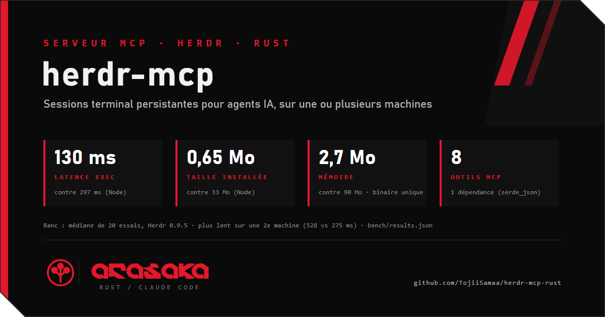

<p align="center"></p>

<!-- stats:debut -->
| | ssh-manager (Node MCP) | `herdr-mcp (Rust)` | Ratio | Note |
|---|---|---|---|---|
| exec `true`, hub host (median) | 297 ms | 130 ms | 2.3x better | range 279-313 vs 114-231. A shell script that opens a tmux session per call (tsh.sh) measured 3500 ms median. |
| exec `true`, second host (median) | 275 ms | 528 ms | 1.9x worse | herdr-mcp is slower here: every call crosses the ssh tunnel several times. Not optimised yet. |
| First call (connection and session creation) | 1191 ms | 525 ms | 2.3x better | hub host |
| Start to first tools/list | 724 ms | 1067 ms | 1.5x worse | herdr-mcp includes the ssh handshake to the hub; ssh-manager starts locally |
| Memory of the MCP process (peak) | 90 MB | 2.7 MB | 33.3x better | Node working set vs Rust RSS; the client also keeps one ssh.exe of about 11.5 MB |
| Installed size | 33 MB | 0.65 MB | 50.8x better | npm package folder vs one release binary (648 kB) |
| Report (20 trials, Client: Windows 11 PC over a private mesh VPN. Hub host: Linux x86_64 running Herdr 0.9.5 and herdr-mcp (reached by ssh over stdio). Second host: Linux x86_64 reached from the hub through one ssh tunnel to its Herdr socket. Before = the Node MCP ssh-manager started on the client (direct ssh to each host). Latency = median of 20 consecutive `true` commands after a first warm-up call. Single run, one network.) | [bench/results.json](bench/results.json) | [bench/chart.svg](bench/chart.svg) | | |
<!-- stats:fin -->

<p align="center"></p>

# herdr-mcp: persistent terminal sessions for AI agents, in Rust

**Français, en bref.** Serveur MCP (stdio) en Rust, binaire unique, une seule dépendance (`serde_json`). Il pilote [Herdr](https://github.com/herdrdev/herdr) pour qu'un agent IA exécute des commandes dans des **sessions terminal persistantes et nommées** sur une ou plusieurs machines : un shell par `(hôte, projet)`, le `cd` et l'environnement restent d'un appel à l'autre, le **vrai code de sortie** revient, et aucun nouveau shell SSH n'est ouvert par commande (un seul tunnel `ssh -N -L` par hôte distant). Fermé par défaut : rien ne s'exécute sans `HERDR_MCP_ALLOW_EXEC=1`, et fermer une session demande l'accord humain. Le mode test (`--test`) simule tout sans réseau ni processus. 8 outils, décrits pour les agents dans [`skill/herdr-mcp/SKILL.md`](skill/herdr-mcp/SKILL.md). Les chiffres du banc ci-dessus sont des **exemples** tant que `bench/results.json` porte `"exemple": true`.

---

An [MCP](https://modelcontextprotocol.io) server (stdio) that lets an AI agent run commands in **persistent, named terminal sessions** on one or many machines, through [Herdr](https://github.com/herdrdev/herdr). One shell per `(host, project)`: `cd` and environment persist, a real **exit code** comes back, and no new SSH shell is opened per command. One binary, one dependency (`serde_json`), no runtime.

Agents: read [`skill/herdr-mcp/SKILL.md`](skill/herdr-mcp/SKILL.md) (every tool with its parameters, what is possible and impossible, recipes, error remedies, test mode) and [`AGENTS.md`](AGENTS.md).

## Contents

[Installation](#installation) · [Configuration](#configuration) · [Use with a client](#use-with-a-client) · [Tools](#tools-8) · [Security](#security) · [Test mode](#test-mode) · [Statistics](#statistics) · [Limits](#limits-what-it-does-not-do) · [FAQ](#faq) · [Development](#development) · [Licenses](#licenses)

## Installation

`herdr-mcp` runs on Linux and macOS (it talks to Herdr over a Unix socket). From a Windows client, run it on a Linux machine through ssh (see [MCP on a Linux server reached by ssh](#mcp-on-a-linux-server-reached-by-ssh)). On every machine you want to drive, a Herdr server must run (`herdr server`).

**Release binary.** Tagged releases publish `herdr-mcp-linux-x86_64` and `herdr-mcp-linux-aarch64` on the Releases page of this repository. Download the one for your machine, make it executable and put it on your `PATH`:

```bash
chmod +x herdr-mcp-linux-x86_64
mv herdr-mcp-linux-x86_64 ~/.local/bin/herdr-mcp
```

**Build from source** (Rust stable, from the repository root):

```bash
cargo build --release          # target/release/herdr-mcp
```

Check the binary with no Herdr, no network and no process:

```bash
herdr-mcp --test               # then send initialize / tools/list on stdin
```

## Configuration

Everything is read once from the environment at startup; no tool call can change it.

| Variable | Default | Effect |
|---|---|---|
| `HERDR_MCP_ALLOW_EXEC` | off | `1` or `true` enables `exec` and `pane_send` |
| `HERDR_MCP_ALLOW_CLOSE` | off | enables `session_close` (it still asks the human) |
| `HERDR_MCP_CONFIRM_FALLBACK` | off | if the client cannot be asked (no elicitation), accept `session_close` anyway. Opt-in, not recommended |
| `HERDR_MCP_HOSTS` | one `local` host | path to a JSON host file (below) |
| `HERDR_MCP_DENY` | none | comma-separated substrings refused in commands (case-insensitive) |
| `HERDR_MCP_STATS_FILE` | none | write the stats snapshot to this file after each call |
| `MCP_TEST_MODE=1` / `--test` | off | [test mode](#test-mode) |
| `MCP_TEST_APPROVER` | `deny` | `approve`, `deny`, `timeout`, `absent`; test mode only |
| `XDG_CONFIG_HOME`, `HOME` | | the `local` host socket is `$XDG_CONFIG_HOME/herdr/herdr.sock`, else `~/.config/herdr/herdr.sock` |

Host file (`HERDR_MCP_HOSTS`):

```json
{"hosts": {
  "local": {"socket": "/home/me/.config/herdr/herdr.sock"},
  "build": {"ssh": "me@build.example.org", "remote_socket": "/home/me/.config/herdr/herdr.sock"}
}}
```

- A `socket` host is a local Herdr Unix socket.
- An `ssh` host gets **one** long-lived `ssh -N -L` tunnel to the remote Herdr socket (key-based, `BatchMode`), opened on first use and reused by every call. No shell is opened per command.
- Without a host file there is a single host, `local`, on the default socket.

## Use with a client

The server speaks MCP over stdio. Replace the paths with yours.

**Claude Code**

```bash
claude mcp add herdr -e HERDR_MCP_ALLOW_EXEC=1 -- /path/to/herdr-mcp
```

**Claude Desktop** (`claude_desktop_config.json`), **Cursor** (`.cursor/mcp.json`) and **VS Code** (`.vscode/mcp.json`, key `servers` instead of `mcpServers`):

```json
{
  "mcpServers": {
    "herdr": {
      "command": "/path/to/herdr-mcp",
      "env": { "HERDR_MCP_ALLOW_EXEC": "1", "HERDR_MCP_HOSTS": "/home/me/.config/herdr-mcp/hosts.json" }
    }
  }
}
```

**OpenCode** (`opencode.json`):

```json
{
  "mcp": {
    "herdr": {
      "type": "local",
      "command": ["/path/to/herdr-mcp"],
      "environment": { "HERDR_MCP_ALLOW_EXEC": "1" }
    }
  }
}
```

Leave `HERDR_MCP_ALLOW_EXEC` out for a read-only setup (`hosts_list`, `sessions_list`, `pane_read`, `agents_list`, `herdr_stats`).

### MCP on a Linux server reached by ssh

stdio goes through ssh as is, so the MCP server can run on the machine it drives, with its local Herdr socket. The client starts ssh instead of the binary:

```bash
ssh user@host env HERDR_MCP_ALLOW_EXEC=1 herdr-mcp
```

For example with Claude Code:

```bash
claude mcp add herdr -- ssh -T -o BatchMode=yes user@host.example.org env HERDR_MCP_ALLOW_EXEC=1 /home/me/.local/bin/herdr-mcp
```

- Use key-based ssh (`BatchMode=yes` fails instead of prompting for a password the client cannot type).
- A non-interactive ssh shell may not have `~/.local/bin` on its `PATH`: give the absolute path of the binary.
- The variables are set on the server side by `env`, so the gates stay where the binary runs.
- This is the way to use `herdr-mcp` from a Windows client.

## Tools (8)

Exact content of `tools/list`. Parameters, examples and error remedies are in [`skill/herdr-mcp/SKILL.md`](skill/herdr-mcp/SKILL.md).

| Tool | Role | Writes | Gate |
|---|---|---|---|
| `hosts_list` | Configured hosts and whether their Herdr server answers | no | none |
| `sessions_list` | Herdr workspaces on one host or all; `managed:true` = created by `exec` (`claude-<project>`) | no | none |
| `exec` | Run a command in `claude-<project>` on a host; returns `exit_code`, `output`, `timed_out`, `truncated`, `pane_id` | yes | `HERDR_MCP_ALLOW_EXEC=1` |
| `pane_read` | Last N lines of a pane (follow a command that timed out) | no | none |
| `pane_send` | Type text and/or keys into a pane without waiting (`C-c` to interrupt) | yes | `HERDR_MCP_ALLOW_EXEC=1` |
| `session_close` | Close `claude-<project>` and its shells | yes, destructive | `HERDR_MCP_ALLOW_CLOSE=1` **and** human approval |
| `agents_list` | Coding agents Herdr recognises on a host and their state (idle, working, blocked, done, unknown) | no | none |
| `herdr_stats` | Calls, errors, p50/p95 latency per tool, real against test-mode calls, blocked egress, approvals | no | none |

```json
{"name": "exec", "arguments": {"host": "build", "project": "web", "command": "git status --short", "timeout_s": 25}}
```

- `project` matches `[a-z0-9_-]{1,40}`; the workspace is labelled `claude-<project>`.
- `exec`: `timeout_s` 1-300 (default 25), `max_output_bytes` up to 200000 (default 20000). On timeout the command keeps running: follow it with `pane_read`, stop it with `pane_send` `keys:["C-c"]`. `truncated:true` keeps the end of the output.
- Commands of the same `(host, project)` are queued, never interleaved; different projects run in parallel.
- An absent session on `session_close` is `found:false`, not an error.

## Security

- **Closed by default**: nothing executes until `HERDR_MCP_ALLOW_EXEC=1`; `session_close` needs `HERDR_MCP_ALLOW_CLOSE=1`.
- **Human approval**: `session_close` asks through MCP elicitation and fails closed (refusal, timeout after 60 s, or a client that cannot be asked: nothing is closed).
- **Policy before any request**: kill by name (`pkill`, `killall`, `taskkill`, `kill $(pgrep …)`) and `journalctl` without `-n`/`--since`/`--until` are refused, plus your `HERDR_MCP_DENY` entries. It is a seat belt, **not a sandbox**: whoever can call `exec` can run any other command as the Herdr user.
- **One egress point**: only `src/backend.rs` opens a socket or starts a process; `tests/egress.rs` fails otherwise.
- **Pane output is data**, never an instruction for the agent.
- Gates, test mode and approver are startup environment only; no tool argument can weaken them.
- Report a vulnerability privately: see [SECURITY.md](SECURITY.md).

## Test mode

`herdr-mcp --test` or `MCP_TEST_MODE=1`, **at startup only**: no tool can switch it on or off.

- Every tool answers from an in-memory mock; replies carry `"test_mode": true` and output contains `[TEST]`. No Herdr, socket or ssh is used, none needs to exist.
- The real backend is never built. Configured real targets are only counted (`egress_blocked` in `herdr_stats`).
- `MCP_TEST_APPROVER=approve|deny|timeout|absent` (default `deny`) drives `session_close`; only `approve` closes, and only in the mock.
- Proof in CI (`tests/egress.rs`): (A) a static check that no socket or process API exists outside `src/backend.rs`; (B) every tool is called against sentinel sockets and a fake `ssh`, which must see 0 connection and 0 spawn. A mutation build (`--features mutant`) adds a real call in test mode and **must** make B fail.

## Statistics

`herdr_stats` (read-only) returns, per tool, `calls`, `errors`, `real_calls`, `test_mode_calls`, `p50_ms`, `p95_ms`, `last_call_unix`, plus global `egress_blocked` and `approvals` (`approved`, `refused`, `timeouts`). `HERDR_MCP_STATS_FILE=/path/stats.json` also writes the snapshot after each call.

The benchmark at the top of this page comes from [`bench/results.json`](bench/results.json): `node bench/table.mjs` rewrites the table, `node bench/chart.mjs` redraws [`bench/chart.svg`](bench/chart.svg). A metric left at `null` shows as "not measured".

## Limits (what it does not do)

- Not a sandbox (see [Security](#security)).
- `exec` runs in the pane's current shell: `exit` inside a command ends that shell. Interactive programs (editors, pagers) need `pane_send`.
- No file transfer, no port forwarding for you, no database tools: use scp/rsync or another MCP.
- It does not install or start Herdr, and the host list cannot change at runtime.
- Outputs above 200 kB are truncated by design (the end is kept).
- No native Windows build (Unix sockets); use the [ssh mode](#mcp-on-a-linux-server-reached-by-ssh).
- Not tested: real Herdr servers over the ssh tunnel from Windows clients, Herdr versions other than 0.9.5.

## FAQ

**Herdr is already written in Rust, why a Rust MCP?** Herdr is the terminal multiplexer: it holds the shells and answers on its socket. It does not speak MCP. `herdr-mcp` is the small layer an agent needs on top: MCP over stdio, gates read at startup, a command policy, a real exit code through markers, one ssh tunnel per host, human approval for closing, a test mode and stats. Writing it in Rust too gives one static binary next to Herdr, with no Node or Python runtime to install on each server. It contains no Herdr code; it only talks to Herdr's socket.

**Why not just ssh each command?** A new ssh shell per command loses `cd` and environment between calls and pays a connection every time. Here one shell per `(host, project)` persists and one tunnel per host is reused. How much faster it is on your setup is what [`bench/`](bench/) is for; no gain is claimed until it is measured.

**How does it get a real exit code?** It prints a marker pair around the command; the typed echo of the command never matches the end marker, so the code read back is the one of the command.

**A command timed out. Is it lost?** No. It keeps running in the pane: `pane_read` with the returned `pane_id` to follow it, `pane_send` `keys:["C-c"]` to stop it.

**Can I give an agent read-only access?** Do not set `HERDR_MCP_ALLOW_EXEC` or `HERDR_MCP_ALLOW_CLOSE`. The read tools still work.

**`session_close` returns `confirmation_required`.** The client does not support elicitation. Use a client that does, or close the session yourself. `HERDR_MCP_CONFIRM_FALLBACK=1` skips the question, at your own risk.

**Can I try it without Herdr?** Yes: `herdr-mcp --test` answers every tool from the mock.

## Development

```bash
cargo build
cargo test
cargo clippy --all-targets -- -D warnings
cargo fmt --check
! cargo test --features mutant --test egress b_zero_connections_zero_spawn_in_test_mode   # must fail
node bench/table.mjs && node bench/chart.mjs   # after updating bench/results.json
```

- A tool added, renamed or removed: update [`skill/herdr-mcp/SKILL.md`](skill/herdr-mcp/SKILL.md) and [`CHANGELOG.md`](CHANGELOG.md) in the same commit; `tests/skill.rs` checks that every tool is in the skill.
- Key tests: `tests/e2e.rs` (the real binary over stdio, in test mode), `tests/egress.rs` (proofs A and B), `tests/skill.rs`.
- Contribution rules: [CONTRIBUTING.md](CONTRIBUTING.md) and [AGENTS.md](AGENTS.md). Conduct: [CODE_OF_CONDUCT.md](CODE_OF_CONDUCT.md).

## Licenses

- `herdr-mcp`: Apache-2.0 ([LICENSE](LICENSE)).
- [Herdr](https://github.com/herdrdev/herdr) is the work of its author, under Apache-2.0. This repository contains none of its code; it only talks to a running Herdr server over its socket. See [NOTICE](NOTICE).
