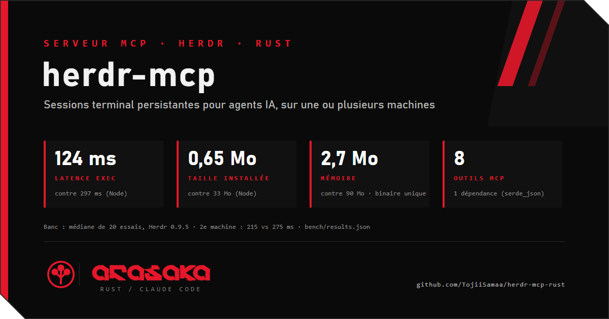

  <!-- scan:ok -->

herdr-mcp est un serveur MCP en Rust qui permet à un agent IA comme Claude d'exécuter des commandes dans des sessions terminal persistantes, sur une ou plusieurs machines, au-dessus de Herdr. Un shell par projet et par machine : le `cd` et l'environnement restent d'un appel à l'autre, le vrai code de sortie revient, et un seul tunnel ssh par machine remplace le shell SSH ouvert à chaque commande. Fermé par défaut (rien ne s'exécute sans autorisation explicite, fermer une session demande l'accord humain), binaire unique, une seule dépendance, et un mode test qui simule tout sans réseau. Mesuré (médiane de 20 essais) : 124 ms par commande sur la machine principale contre 297 ms pour le MCP Node qu'il remplace, 215 ms contre 275 ms sur une machine distante, 2,7 Mo de mémoire contre 90 Mo, 0,65 Mo installé contre 33 Mo.

https://github.com/TojiiSamaa/herdr-mcp-rust  <!-- scan:ok -->
